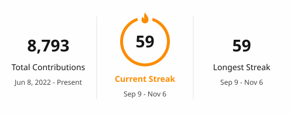

<h1 align="center">Hi, I'm Gianluca 👋</h1>

<b>Senior Full-Stack Developer</b> · Web & Mobile · Parma, Italy 🇮🇹

  
  
  

---

### About me

- 💼 **9 years** building production software, end to end
- 📱 Cross-platform mobile with **Flutter**, backends in **Node.js** and **.NET**, data on **PostgreSQL**
- ♻️ Obsessed with reusable architecture — I maintain [my own full-stack boilerplate](https://zakstackhq.com) to go from idea to MVP fast
- 🤝 Open to **freelance work**: MVPs from scratch, Flutter mobile apps, backend & architecture

### What I'm working on

  

- 🧰 A **universal full-stack boilerplate** (auth, roles, payments, notifications) extracted from real production code — now live at **[zakstackhq.com](https://zakstackhq.com)**

### Tech stack

**Backend**
 

**Frontend & Mobile**
 

**Data & Infra**
 

### Activity

  

Most of my work lives in private client repositories.

---

<i>Let's build something useful. Reach out on <a href="https://www.linkedin.com/in/gianluca-zaccarelli-389807153/">LinkedIn</a>.</i>
